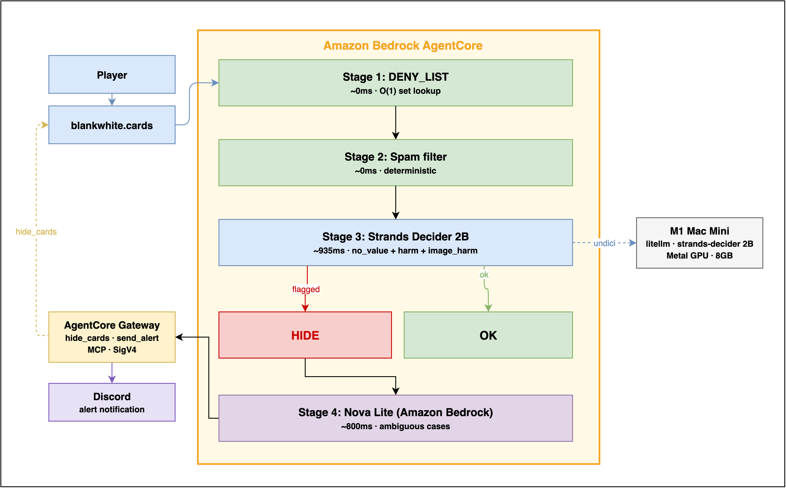

[Blank White Cards](https://blankwhite.cards) is a community card game with a simple premise: there are no rules. Players write and draw their own cards and contribute to a global public deck. Predictably, when you give a blank canvas to the internet you will get a lot of doodles - most of them crude, rude and with a hilarious no-filter attitude. But every now and then something comes through that crosses the line from spicy satire into genuine harm; hate speech, personal threats, and content that doesn't belong in any game regardless of how much freedom there is. Those cards need to be flagged and promptly reviewed, to help keep the fun going for everyone else.

---

## The "Old" way

My first moderation agent was simple sentiment analysis - a single pass through Amazon Nova Lite, asking whether it should be hidden, and calling the `hide_cards` tool if so. This worked okay for small batch jobs of occasional cards but there were two outstanding problems:

The first was performance and capability. Nova Lite isn't very expensive but running it across hundreds of cards repeatedly to iterate and optimise the moderation prompts stacks up. At the time of writing I have 860 cards in the global deck and a full-deck text-only sweep takes a few minutes - mostly waiting on output token generation. Vision capability was out of the question as using those models would have required significantly more input context and blown out my processing times and bills.

The second problem is more fundamental. Ironically **Nova's own content safety guardrails fire on exactly the content you are trying to moderate.** When inputting tokens containing anything resembling hate speech, threats or slurs, the model simply errors and refuses to output a response. I worked around this by using the exception as a heuristic that if the model declines to engage, the card probably warrants hiding. Yet this was inaccurate; crude humour trips the guardrail just as readily as genuine incitement, whilst obfuscated hate speech that avoids obvious trigger phrases sails through.

You end up trying to cut the safety nets in order to build safer tooling.

---

## A model that just does it

I was lucky enough to attend AWS Community Day Australia in Brisbane, where Mike Chambers gave a keynote on the advent of small models. In particular I got to learn about Strands Decider, a small decision model. Decision models generate no text, but rather fill out a multiple choice question and answer sheet with levels of confidence. This class of model is small enough to run locally, fast enough to run for real-time decisions, and most importantly has no guardrails that suppress output text.

That same day I had prototyped a new version of my moderator agent on my mac locally - simply by swapping out LLM inference with Strands Decider. It was straightforward since my agent was already written in Strands SDK, all I needed was to update and use the new client.

The fit for content moderation is practically perfect. Strands Decider reads the card as `state`, receives a choice question (hide or ok) and returns a calibrated score between zero and one. If we need to hide then we handoff to Nova for a final pass and tool calling. No token generation means no guardrail trigger path. You can present it with the most hateful content in the deck and it will return a score of 0.90 without hesitation, exception, or refusal. Just a number, consistently, on any input.

---

## The pipeline



The agent implements four sequential stages, each cheaper and faster than the last, designed so that cards requiring action exit as early as possible.

Stage 1 is a human-authored deny list for direct hard blocks. Stage 2 catches deterministic junk: gibberish, empty submissions, and duplicate spam.

Stage 3 calls the Strands Decider with three distinct questions:
- no_value: whether the card has any semblance of gameplay value or is just spam that has made it through the base filters
- harm: detections for hate speech, threats, and other harmful content in the text
- image_harm: detections for hate symbols and graphically explicit content in the image

Each of these questions and their thresholds are independently tunable. A single compound question would dilute the score across multiple dimensions and make threshold calibration unreliable. The no_value and harm questions produce meaningfully different score distributions, and each needs its own decision boundary. The architecture of decision models makes this straightforward: multiple questions are answered in a single forward pass, loading state only once, so there is no latency penalty for asking three questions instead of one.

Stage 4 calls Nova in the case that there is an action flagged for a final review, and to action the tool calls. The agent can call `hide_cards` on the AgentCore gateway to update the card CDN and `send_alert` to notify me via Discord.

With the old Nova-only approach, every card paid the ~800ms Nova inference cost. With this pipeline, cards flagged at stages 1 or 2 exit immediately at near-zero cost. Cards that pass through to Stage 3 pay the Decider inference cost, and only genuinely ambiguous cases reach Nova at stage 4. A full deck sweep takes longer than a naive single-question pass: three questions per card, plus a separate image call for cards that carry drawings. But at a cost that would be completely prohibitive with a frontier vision model, on self-hosted hardware the marginal cost is electricity.

| Method | M1 | M5 Pro | Bedrock |
|---|---|---|---|
| Nova Lite text pass (old) | | | ~800ms |
| Decider 2B text questions | ~450ms | ~140ms | ? |
| Decider 2B image pass | ~9s | ~3s | ? |

---

## Deployment

The agent runs as a container on Amazon Bedrock AgentCore Runtime in `ap-southeast-2`. Strands Decider 2B is not yet available on Bedrock directly, so the container reaches the self-hosted inference endpoint over Tailscale by bootstrapping an ephemeral connection into my Tailnet.

### Container runtime

The container starts Tailscale, waits for it to connect, then launches the agent:

```
start.sh
  tailscaled --outbound-http-proxy-listen=:1080
  tailscale up --hostname=core-overseer
  node main.js

main.js
  POST /invocations  ->  scoreItem() pipeline
  Decider calls      ->  undici EnvHttpProxyAgent -> ALL_PROXY=localhost:1080
  Nova calls         ->  BedrockRuntimeClient (inference profile)
  Gateway calls      ->  MCP SigV4 -> hide_cards, send_alert
```

### Network path: container → Decider

Strands Decider 2B runs on an M1 Mac Mini (8GB unified memory, Metal GPU), served through litellm behind Caddy, accessible over Tailscale:

```
AgentCore container
    ALL_PROXY=http://localhost:1080
    |
    v
tailscaled (userspace-networking)
    DERP relay -- UDP blocked, TCP/HTTPS only
    ACL: tag:overseer -> tag:supply:80
    |
    v
your-decider-host (inference server)
    Caddy :80 -> litellm :4000
    litellm -> strands-decider :8000 (Metal GPU)
```

Notes on implementation:

**Node's native `fetch` ignores proxy environment variables entirely.** Setting `ALL_PROXY` or `HTTP_PROXY` has no effect whatsoever on the standard fetch API, which means Decider calls fail silently even when Tailscale is fully connected and the proxy is listening. The solution is `undici`'s `EnvHttpProxyAgent`, which correctly honours the environment variable and routes outbound requests through tailscaled's HTTP CONNECT proxy at `:1080`.

**A fresh Tailscale auth in a UDP-blocked container takes approximately six minutes** over the DERP relay, which renders cold starts completely impractical. The fix is to generate an authenticated state blob once in a Linux container, base64-encode it, store it in SSM SecureString as `TS_STATE`, and have the container decode and write it to disk on startup before calling `tailscale up`. Cold start time drops from six minutes to approximately eight seconds.

Both of these workarounds might be addressed once decision models become available natively on Amazon Bedrock.

### Secrets

```
SSM SecureString (ap-southeast-2)
  /overseer/DECIDER_KEY     -- litellm bearer token
  /overseer/TS_AUTHKEY      -- Tailscale ephemeral auth key
  /overseer/TS_STATE        -- pre-authenticated Tailscale state (base64)
  /overseer/NOVA_MODEL_ID   -- Nova Lite inference profile
```

---

## What this makes possible

At present, moderation runs as a batch job against the full deck. Text-only decider takes approximately 935ms end-to-end through litellm, which is fast enough to evaluate every card inline before it is submitted or played and before it ever reaches another player's screen. With a generative model, real-time moderation was prohibitively slow and expensive; with a decision model it is now within reach. This opens the door to applying moderation to multiplayer custom-games at scale too.

## Reusable pattern

The core pattern was simply to put Decider before the generative model in the pipeline. Scoring basic decisions before escalating to larger more open-ended inference helps to save time, but also eliminates the entire headache around accidentally tripping guardrails.

Customise your criteria as concrete examples rather than abstract principles. At 2B scale the model pattern-matches on shape far more reliably than it reasons from first principles. Abstract rule-based criteria achieved 0/7 hide recall on the control data set; whilst few-shot example criteria achieved 7/7 with the same threshold. Also run vision tasks as a separate question, since image tokens bleed into the text context and vice versa.

But the most important lesson is to continue to maintain a human-authored deny list for your trickiest edge cases. The overseer does not replace the human in the loop, it simply acts swiftly to the best of its knowledge on what your moderation standards already are. At the end of the day somebody still needs to be accountable for what gets decided, and that ownership can never be delegated solely to a probability.

The full decision pattern with wiring code is in the repository: [`docs/patterns/content-moderation.md`](https://github.com/mcteamstar/overseer/blob/main/docs/patterns/content-moderation.md)

## Conclusion

I've been running the game since 2019 and accumulated all sorts of weird and wacky cards, and lately AI has transformed the capability to create and foster joyful user experiences. Overseer is just one of many enhancements I've added to the gaming experience this year. You can even play custom games with your agents via the MCP https://github.com/mcteamster/white/tree/main/mcp. Drop by and check out [Blank White Cards](https://blankwhite.cards) if you dare. Create a card to say hi - I'll just hope you don't try to break the limits of the Overseer.